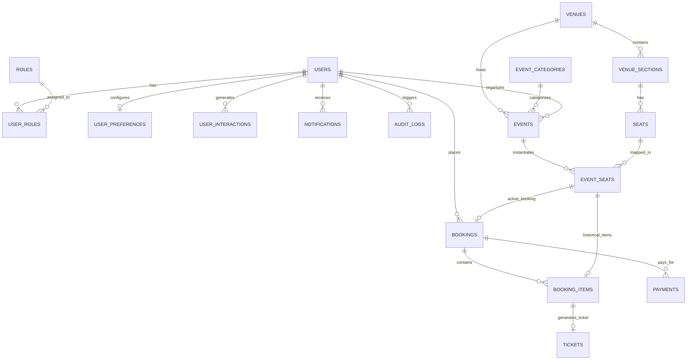
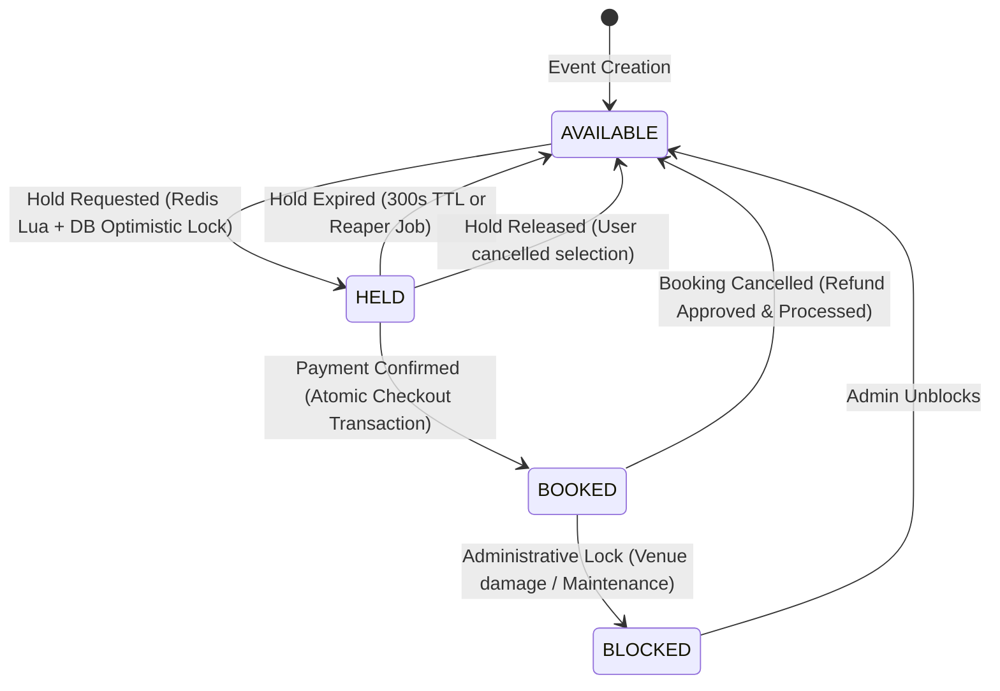

# SeatSync AI – Comprehensive Database & Vector Store Design

## 1. Relational Database Schema (MySQL 8.0)

The relational schema is normalized to 3NF, enforcing referential integrity, foreign key cascades, and unique constraints to guarantee transactional consistency.



---

### 1.1 Complete MySQL Table DDL & Column Definitions

#### 1. `roles`
Stores standard user authorization roles.
```sql
CREATE TABLE roles (
    id BIGINT AUTO_INCREMENT PRIMARY KEY,
    name VARCHAR(50) NOT NULL UNIQUE COMMENT 'ROLE_CUSTOMER, ROLE_ORGANIZER, ROLE_ADMIN',
    description VARCHAR(255) NULL,
    created_at TIMESTAMP DEFAULT CURRENT_TIMESTAMP
) ENGINE=InnoDB DEFAULT CHARSET=utf8mb4 COLLATE=utf8mb4_unicode_ci;
```

#### 2. `users`
Core user account credentials and profile attributes.
```sql
CREATE TABLE users (
    id BIGINT AUTO_INCREMENT PRIMARY KEY,
    email VARCHAR(180) NOT NULL UNIQUE,
    password_hash VARCHAR(255) NOT NULL,
    full_name VARCHAR(120) NOT NULL,
    phone_number VARCHAR(25) NULL,
    avatar_url VARCHAR(500) NULL,
    status ENUM('ACTIVE', 'SUSPENDED', 'PENDING_VERIFICATION') DEFAULT 'ACTIVE',
    created_at TIMESTAMP DEFAULT CURRENT_TIMESTAMP,
    updated_at TIMESTAMP DEFAULT CURRENT_TIMESTAMP ON UPDATE CURRENT_TIMESTAMP,
    INDEX idx_users_email (email),
    INDEX idx_users_status (status)
) ENGINE=InnoDB DEFAULT CHARSET=utf8mb4 COLLATE=utf8mb4_unicode_ci;
```

#### 3. `user_roles`
Join table linking users to security roles.
```sql
CREATE TABLE user_roles (
    user_id BIGINT NOT NULL,
    role_id BIGINT NOT NULL,
    PRIMARY KEY (user_id, role_id),
    CONSTRAINT fk_ur_user FOREIGN KEY (user_id) REFERENCES users (id) ON DELETE CASCADE,
    CONSTRAINT fk_ur_role FOREIGN KEY (role_id) REFERENCES roles (id) ON DELETE RESTRICT
) ENGINE=InnoDB DEFAULT CHARSET=utf8mb4 COLLATE=utf8mb4_unicode_ci;
```

#### 4. `user_preferences`
Captures preferences utilized by the personalized recommendation engine.
```sql
CREATE TABLE user_preferences (
    id BIGINT AUTO_INCREMENT PRIMARY KEY,
    user_id BIGINT NOT NULL UNIQUE,
    preferred_city VARCHAR(100) NULL,
    budget_min DECIMAL(10,2) DEFAULT 0.00,
    budget_max DECIMAL(10,2) DEFAULT 10000.00,
    favorite_categories JSON NULL COMMENT 'Array of category IDs or slugs, e.g. ["concerts", "sports"]',
    created_at TIMESTAMP DEFAULT CURRENT_TIMESTAMP,
    updated_at TIMESTAMP DEFAULT CURRENT_TIMESTAMP ON UPDATE CURRENT_TIMESTAMP,
    CONSTRAINT fk_up_user FOREIGN KEY (user_id) REFERENCES users (id) ON DELETE CASCADE
) ENGINE=InnoDB DEFAULT CHARSET=utf8mb4 COLLATE=utf8mb4_unicode_ci;
```

#### 5. `user_interactions`
Logs implicit interactions for behavioral analytics and recommendations.
```sql
CREATE TABLE user_interactions (
    id BIGINT AUTO_INCREMENT PRIMARY KEY,
    user_id BIGINT NOT NULL,
    event_id BIGINT NOT NULL,
    interaction_type ENUM('VIEW', 'SEARCH_CLICK', 'WISHLIST_ADD', 'BOOKING_INITIATED', 'SHARE') NOT NULL,
    metadata JSON NULL,
    created_at TIMESTAMP DEFAULT CURRENT_TIMESTAMP,
    INDEX idx_ui_user_event (user_id, event_id),
    INDEX idx_ui_type_created (interaction_type, created_at)
) ENGINE=InnoDB DEFAULT CHARSET=utf8mb4 COLLATE=utf8mb4_unicode_ci;
```

#### 6. `venues`
Physical locations hosting events.
```sql
CREATE TABLE venues (
    id BIGINT AUTO_INCREMENT PRIMARY KEY,
    name VARCHAR(150) NOT NULL,
    address VARCHAR(255) NOT NULL,
    city VARCHAR(100) NOT NULL,
    state VARCHAR(100) NOT NULL,
    postal_code VARCHAR(20) NOT NULL,
    country VARCHAR(100) DEFAULT 'India',
    latitude DECIMAL(10,7) NULL,
    longitude DECIMAL(10,7) NULL,
    total_capacity INT NOT NULL,
    image_url VARCHAR(500) NULL,
    created_at TIMESTAMP DEFAULT CURRENT_TIMESTAMP,
    updated_at TIMESTAMP DEFAULT CURRENT_TIMESTAMP ON UPDATE CURRENT_TIMESTAMP,
    INDEX idx_venues_city (city)
) ENGINE=InnoDB DEFAULT CHARSET=utf8mb4 COLLATE=utf8mb4_unicode_ci;
```

#### 7. `venue_sections`
Logical structural divisions of a venue (e.g., VIP Front, Platinum, Gold, Upper Balcony).
```sql
CREATE TABLE venue_sections (
    id BIGINT AUTO_INCREMENT PRIMARY KEY,
    venue_id BIGINT NOT NULL,
    name VARCHAR(80) NOT NULL,
    tier_level INT NOT NULL COMMENT '1=VIP, 2=Premium, 3=Standard, etc.',
    capacity INT NOT NULL,
    base_multiplier DECIMAL(4,2) DEFAULT 1.00 COMMENT 'Section pricing multiplier against event base price',
    created_at TIMESTAMP DEFAULT CURRENT_TIMESTAMP,
    CONSTRAINT fk_vs_venue FOREIGN KEY (venue_id) REFERENCES venues (id) ON DELETE CASCADE,
    INDEX idx_vs_venue (venue_id)
) ENGINE=InnoDB DEFAULT CHARSET=utf8mb4 COLLATE=utf8mb4_unicode_ci;
```

#### 8. `seats`
Static physical seat blueprints inside venue sections.
```sql
CREATE TABLE seats (
    id BIGINT AUTO_INCREMENT PRIMARY KEY,
    venue_id BIGINT NOT NULL,
    section_id BIGINT NOT NULL,
    row_label VARCHAR(10) NOT NULL,
    seat_number INT NOT NULL,
    seat_type ENUM('REGULAR', 'VIP', 'WHEELCHAIR_ACCESSIBLE', 'AISLE') DEFAULT 'REGULAR',
    grid_x INT NOT NULL COMMENT 'X-coordinate for graphical canvas layout',
    grid_y INT NOT NULL COMMENT 'Y-coordinate for graphical canvas layout',
    created_at TIMESTAMP DEFAULT CURRENT_TIMESTAMP,
    CONSTRAINT fk_s_venue FOREIGN KEY (venue_id) REFERENCES venues (id) ON DELETE CASCADE,
    CONSTRAINT fk_s_section FOREIGN KEY (section_id) REFERENCES venue_sections (id) ON DELETE CASCADE,
    UNIQUE KEY uk_section_row_number (section_id, row_label, seat_number),
    INDEX idx_seats_section (section_id)
) ENGINE=InnoDB DEFAULT CHARSET=utf8mb4 COLLATE=utf8mb4_unicode_ci;
```

#### 9. `event_categories`
Taxonomy categories for events.
```sql
CREATE TABLE event_categories (
    id BIGINT AUTO_INCREMENT PRIMARY KEY,
    name VARCHAR(80) NOT NULL UNIQUE,
    slug VARCHAR(80) NOT NULL UNIQUE,
    icon VARCHAR(50) NULL,
    description VARCHAR(255) NULL,
    created_at TIMESTAMP DEFAULT CURRENT_TIMESTAMP
) ENGINE=InnoDB DEFAULT CHARSET=utf8mb4 COLLATE=utf8mb4_unicode_ci;
```

#### 10. `events`
Specific scheduled event occurrences.
```sql
CREATE TABLE events (
    id BIGINT AUTO_INCREMENT PRIMARY KEY,
    title VARCHAR(200) NOT NULL,
    slug VARCHAR(220) NOT NULL UNIQUE,
    short_description VARCHAR(300) NOT NULL,
    description TEXT NOT NULL,
    category_id BIGINT NOT NULL,
    venue_id BIGINT NOT NULL,
    organizer_id BIGINT NOT NULL,
    banner_image_url VARCHAR(500) NULL,
    thumbnail_url VARCHAR(500) NULL,
    start_time DATETIME NOT NULL,
    end_time DATETIME NOT NULL,
    status ENUM('DRAFT', 'PUBLISHED', 'CANCELLED', 'COMPLETED') DEFAULT 'DRAFT',
    base_price DECIMAL(10,2) NOT NULL,
    max_tickets_per_user INT DEFAULT 6,
    created_at TIMESTAMP DEFAULT CURRENT_TIMESTAMP,
    updated_at TIMESTAMP DEFAULT CURRENT_TIMESTAMP ON UPDATE CURRENT_TIMESTAMP,
    CONSTRAINT fk_e_category FOREIGN KEY (category_id) REFERENCES event_categories (id),
    CONSTRAINT fk_e_venue FOREIGN KEY (venue_id) REFERENCES venues (id),
    CONSTRAINT fk_e_organizer FOREIGN KEY (organizer_id) REFERENCES users (id),
    INDEX idx_events_start_status (start_time, status),
    INDEX idx_events_category (category_id),
    INDEX idx_events_venue (venue_id)
) ENGINE=InnoDB DEFAULT CHARSET=utf8mb4 COLLATE=utf8mb4_unicode_ci;
```

#### 11. `event_seats`
The live seat inventory for a given event. **Crucial table for concurrency.**
```sql
CREATE TABLE event_seats (
    id BIGINT AUTO_INCREMENT PRIMARY KEY,
    event_id BIGINT NOT NULL,
    seat_id BIGINT NOT NULL,
    price DECIMAL(10,2) NOT NULL,
    status ENUM('AVAILABLE', 'HELD', 'BOOKED', 'BLOCKED') DEFAULT 'AVAILABLE',
    held_by_user_id BIGINT NULL,
    held_until DATETIME NULL,
    hold_token VARCHAR(64) NULL COMMENT 'Unique UUID token for ownership-safe Redis compare-and-delete',
    current_booking_id BIGINT NULL COMMENT 'Points to active booking when BOOKED; NULL when AVAILABLE/HELD/CANCELLED',
    version BIGINT NOT NULL DEFAULT 0 COMMENT 'JPA Optimistic Lock Version',
    created_at TIMESTAMP DEFAULT CURRENT_TIMESTAMP,
    updated_at TIMESTAMP DEFAULT CURRENT_TIMESTAMP ON UPDATE CURRENT_TIMESTAMP,
    CONSTRAINT fk_es_event FOREIGN KEY (event_id) REFERENCES events (id) ON DELETE CASCADE,
    CONSTRAINT fk_es_seat FOREIGN KEY (seat_id) REFERENCES seats (id) ON DELETE RESTRICT,
    CONSTRAINT fk_es_user FOREIGN KEY (held_by_user_id) REFERENCES users (id) ON DELETE SET NULL,
    CONSTRAINT fk_es_booking FOREIGN KEY (current_booking_id) REFERENCES bookings (id) ON DELETE SET NULL,
    UNIQUE KEY uk_event_seat (event_id, seat_id),
    INDEX idx_es_event_status (event_id, status),
    INDEX idx_es_held_expiry (status, held_until),
    INDEX idx_es_current_booking (current_booking_id)
) ENGINE=InnoDB DEFAULT CHARSET=utf8mb4 COLLATE=utf8mb4_unicode_ci;
```

#### 12. `bookings`
Master record for customer reservations.
```sql
CREATE TABLE bookings (
    id BIGINT AUTO_INCREMENT PRIMARY KEY,
    booking_reference VARCHAR(32) NOT NULL UNIQUE COMMENT 'Formatted code: e.g. SS-2026-X9K2L1',
    user_id BIGINT NOT NULL,
    event_id BIGINT NOT NULL,
    total_amount DECIMAL(10,2) NOT NULL,
    discount_amount DECIMAL(10,2) DEFAULT 0.00,
    final_amount DECIMAL(10,2) NOT NULL,
    status ENUM('PENDING', 'CONFIRMED', 'CANCELLED', 'REFUNDED') DEFAULT 'PENDING',
    idempotency_key VARCHAR(120) NOT NULL UNIQUE,
    cancellation_reason VARCHAR(255) NULL,
    cancelled_at DATETIME NULL,
    created_at TIMESTAMP DEFAULT CURRENT_TIMESTAMP,
    updated_at TIMESTAMP DEFAULT CURRENT_TIMESTAMP ON UPDATE CURRENT_TIMESTAMP,
    CONSTRAINT fk_b_user FOREIGN KEY (user_id) REFERENCES users (id),
    CONSTRAINT fk_b_event FOREIGN KEY (event_id) REFERENCES events (id),
    INDEX idx_bookings_user (user_id),
    INDEX idx_bookings_status (status)
) ENGINE=InnoDB DEFAULT CHARSET=utf8mb4 COLLATE=utf8mb4_unicode_ci;
```

#### 13. `booking_items`
Individual seat items bound to a booking. Enables seat rebooking after cancellation while retaining historical audit logs.
```sql
CREATE TABLE booking_items (
    id BIGINT AUTO_INCREMENT PRIMARY KEY,
    booking_id BIGINT NOT NULL,
    event_seat_id BIGINT NOT NULL,
    unit_price DECIMAL(10,2) NOT NULL,
    status ENUM('CONFIRMED', 'CANCELLED', 'REFUNDED') DEFAULT 'CONFIRMED',
    created_at TIMESTAMP DEFAULT CURRENT_TIMESTAMP,
    updated_at TIMESTAMP DEFAULT CURRENT_TIMESTAMP ON UPDATE CURRENT_TIMESTAMP,
    CONSTRAINT fk_bi_booking FOREIGN KEY (booking_id) REFERENCES bookings (id) ON DELETE RESTRICT,
    CONSTRAINT fk_bi_event_seat FOREIGN KEY (event_seat_id) REFERENCES event_seats (id) ON DELETE RESTRICT,
    UNIQUE KEY uk_booking_seat (booking_id, event_seat_id) COMMENT 'Prevents duplicate seat addition within the same booking',
    INDEX idx_bi_event_seat_status (event_seat_id, status)
) ENGINE=InnoDB DEFAULT CHARSET=utf8mb4 COLLATE=utf8mb4_unicode_ci;
```

#### 14. `payments`
Financial transaction attempts and confirmations.
```sql
CREATE TABLE payments (
    id BIGINT AUTO_INCREMENT PRIMARY KEY,
    booking_id BIGINT NOT NULL,
    payment_reference VARCHAR(64) NOT NULL UNIQUE,
    provider ENUM('MOCK_GATEWAY', 'STRIPE', 'RAZORPAY') DEFAULT 'MOCK_GATEWAY',
    amount DECIMAL(10,2) NOT NULL,
    currency VARCHAR(3) DEFAULT 'INR',
    status ENUM('INITIATED', 'SUCCESS', 'FAILED', 'REFUNDED') DEFAULT 'INITIATED',
    idempotency_key VARCHAR(120) NOT NULL UNIQUE,
    payment_method VARCHAR(50) DEFAULT 'CREDIT_CARD',
    raw_response JSON NULL,
    created_at TIMESTAMP DEFAULT CURRENT_TIMESTAMP,
    updated_at TIMESTAMP DEFAULT CURRENT_TIMESTAMP ON UPDATE CURRENT_TIMESTAMP,
    CONSTRAINT fk_p_booking FOREIGN KEY (booking_id) REFERENCES bookings (id) ON DELETE CASCADE,
    INDEX idx_payments_status (status)
) ENGINE=InnoDB DEFAULT CHARSET=utf8mb4 COLLATE=utf8mb4_unicode_ci;
```

#### 15. `tickets`
Digital admission tokens with QR code verification data.
```sql
CREATE TABLE tickets (
    id BIGINT AUTO_INCREMENT PRIMARY KEY,
    booking_item_id BIGINT NOT NULL UNIQUE,
    ticket_number VARCHAR(40) NOT NULL UNIQUE,
    qr_code_data VARCHAR(500) NOT NULL COMMENT 'Payload containing signed JWT/HMAC token',
    qr_code_hash VARCHAR(128) NOT NULL COMMENT 'HMAC-SHA256 signature for offline/online scan validation',
    status ENUM('VALID', 'CHECKED_IN', 'CANCELLED') DEFAULT 'VALID',
    checked_in_at DATETIME NULL,
    created_at TIMESTAMP DEFAULT CURRENT_TIMESTAMP,
    CONSTRAINT fk_t_item FOREIGN KEY (booking_item_id) REFERENCES booking_items (id) ON DELETE CASCADE,
    INDEX idx_tickets_number (ticket_number),
    INDEX idx_tickets_status (status)
) ENGINE=InnoDB DEFAULT CHARSET=utf8mb4 COLLATE=utf8mb4_unicode_ci;
```

#### 16. `notifications`
Customer and system alerts.
```sql
CREATE TABLE notifications (
    id BIGINT AUTO_INCREMENT PRIMARY KEY,
    user_id BIGINT NOT NULL,
    title VARCHAR(150) NOT NULL,
    message TEXT NOT NULL,
    type ENUM('BOOKING_CONFIRMATION', 'SEAT_RELEASED', 'REMINDER', 'SYSTEM_ALERT') NOT NULL,
    is_read BOOLEAN DEFAULT FALSE,
    created_at TIMESTAMP DEFAULT CURRENT_TIMESTAMP,
    CONSTRAINT fk_n_user FOREIGN KEY (user_id) REFERENCES users (id) ON DELETE CASCADE,
    INDEX idx_notif_user_unread (user_id, is_read)
) ENGINE=InnoDB DEFAULT CHARSET=utf8mb4 COLLATE=utf8mb4_unicode_ci;
```

#### 17. `audit_logs`
Security and administrative action trails.
```sql
CREATE TABLE audit_logs (
    id BIGINT AUTO_INCREMENT PRIMARY KEY,
    user_id BIGINT NULL,
    action VARCHAR(80) NOT NULL,
    entity_type VARCHAR(60) NOT NULL,
    entity_id VARCHAR(60) NOT NULL,
    ip_address VARCHAR(45) NULL,
    details_json JSON NULL,
    created_at TIMESTAMP DEFAULT CURRENT_TIMESTAMP,
    INDEX idx_audit_entity (entity_type, entity_id),
    INDEX idx_audit_created (created_at)
) ENGINE=InnoDB DEFAULT CHARSET=utf8mb4 COLLATE=utf8mb4_unicode_ci;
```

---

## 2. Vector Database Schema (PostgreSQL 16 + pgvector)

PostgreSQL with the `pgvector` extension provides dedicated semantic vector search capabilities using 768-dimensional float vectors generated by Google Gemini `text-embedding-004`.

### 2.1 Extension & PostgreSQL Tables DDL

```sql
-- Enable the pgvector extension
CREATE EXTENSION IF NOT EXISTS vector;

-- Table 1: Event Semantic Embeddings
CREATE TABLE event_embeddings (
    id UUID PRIMARY KEY DEFAULT gen_random_uuid(),
    event_id BIGINT NOT NULL UNIQUE,
    title VARCHAR(255) NOT NULL,
    category VARCHAR(100) NOT NULL,
    city VARCHAR(100) NOT NULL,
    content_text TEXT NOT NULL,
    metadata JSONB NOT NULL DEFAULT '{}'::jsonb,
    embedding vector(768) NOT NULL,
    created_at TIMESTAMP WITH TIME ZONE DEFAULT CURRENT_TIMESTAMP,
    updated_at TIMESTAMP WITH TIME ZONE DEFAULT CURRENT_TIMESTAMP
);

-- HNSW Cosine Distance Index for sub-5ms similarity lookups
CREATE INDEX idx_event_embeddings_hnsw 
ON event_embeddings 
USING hnsw (embedding vector_cosine_ops)
WITH (m = 16, ef_construction = 64);

-- Table 2: RAG Knowledge Base Documents (Policies, FAQs)
CREATE TABLE policy_documents (
    id UUID PRIMARY KEY DEFAULT gen_random_uuid(),
    document_title VARCHAR(200) NOT NULL,
    document_type VARCHAR(50) NOT NULL COMMENT 'REFUND_POLICY, CANCELLATION, FAQ, TERMS',
    file_path VARCHAR(500) NULL,
    total_chunks INT DEFAULT 0,
    created_at TIMESTAMP WITH TIME ZONE DEFAULT CURRENT_TIMESTAMP
);

-- Table 3: RAG Document Chunk Embeddings
CREATE TABLE policy_document_embeddings (
    id UUID PRIMARY KEY DEFAULT gen_random_uuid(),
    document_id UUID NOT NULL REFERENCES policy_documents(id) ON DELETE CASCADE,
    chunk_index INT NOT NULL,
    chunk_text TEXT NOT NULL,
    metadata JSONB NOT NULL DEFAULT '{}'::jsonb,
    embedding vector(768) NOT NULL,
    created_at TIMESTAMP WITH TIME ZONE DEFAULT CURRENT_TIMESTAMP
);

CREATE INDEX idx_policy_embeddings_hnsw 
ON policy_document_embeddings 
USING hnsw (embedding vector_cosine_ops)
WITH (m = 16, ef_construction = 64);
```

---

## 3. Redis Key Taxonomy & Ephemeral State Design

Redis serves as an ultra-fast atomic coordination layer.

| Key Pattern | Data Type | TTL | Purpose |
|---|---|---|---|
| `seat:hold:{eventId}:{seatId}` | String (`holdToken`) | 300s (5 min) | Ephemeral seat reservation lock holding a unique UUID `holdToken`. |
| `idempotency:{key}` | String (Status JSON) | 86400s (24h) | Prevents duplicate booking or payment submission. |
| `cache:event:{id}` | String (JSON) | 600s (10 min) | High-speed cache for event details and venue layout. |
| `rate:chat:{userId}` | Integer (Counter) | 60s (1 min) | Rate-limiting AI chat queries (e.g. max 20 prompts/min). |
| `user:cart:{userId}` | Set of `seatId` | 300s (5 min) | Fast lookup of seats currently in user checkout tray. |

### 3.1 Redis Lua Scripts for Ownership-Safe Operations

#### A. Atomic Multi-Seat Hold Acquisition Script:
```lua
-- KEYS = array of seat hold keys, e.g., ["seat:hold:1:101", "seat:hold:1:102"]
-- ARGV[1] = holdToken (Unique UUID), ARGV[2] = ttlInSeconds (300)

for i, key in ipairs(KEYS) do
    if redis.call('EXISTS', key) == 1 then
        return 0 -- Failed: at least one seat is already held
    end
end

for i, key in ipairs(KEYS) do
    redis.call('SET', key, ARGV[1], 'EX', tonumber(ARGV[2]))
end

return 1 -- Success: all seats locked atomically
```

#### B. Atomic Ownership-Safe Compare-and-Delete (CAD) Script:
```lua
-- KEYS[1] = seat:hold:{eventId}:{seatId}
-- ARGV[1] = expectedHoldToken

if redis.call('GET', KEYS[1]) == ARGV[1] then
    return redis.call('DEL', KEYS[1]) -- 1 = Successfully deleted owned key
else
    return 0 -- Key held by another user/token or already expired; do NOT delete!
end
```

---

## 4. Seat State Machine & Rebooking Mechanics

To guarantee that seats can be seamlessly cancelled and rebooked without violating referential integrity or historical accounting, the platform enforces the following state transitions:



### 4.1 Rebooking After Cancellation Protocol

1. **Step 1: Cancellation Execution (`POST /api/bookings/{id}/cancel`)**:
   - `bookings`: `status` changes from `CONFIRMED` to `CANCELLED`, `cancellation_reason` and `cancelled_at` are recorded.
   - `booking_items`: `status` transitions from `CONFIRMED` to `CANCELLED` (retaining full audit and pricing records for financial reconciliation).
   - `tickets`: `status` changes from `VALID` to `CANCELLED`.
   - `event_seats`:
     ```sql
     UPDATE event_seats 
     SET status = 'AVAILABLE',
         current_booking_id = NULL,
         held_by_user_id = NULL,
         held_until = NULL,
         version = version + 1
     WHERE id IN (:cancelledSeatIds) AND current_booking_id = :bookingId;
     ```
   - WebSocket Broadcast: Pushes `status: 'AVAILABLE'` to `/topic/events/{eventId}/seats`.

2. **Step 2: Subsequent Rebooking by Another Customer**:
   - Because `booking_items` utilizes `UNIQUE KEY uk_booking_seat (booking_id, event_seat_id)` (scoped per booking, NOT globally across the table), the newly booked seat creates a fresh `booking_item` row linked to the new `booking_id`.
   - The historical cancelled `booking_item` remains intact for accounting, while the new customer's active booking is established with zero constraint collisions.

### 4.2 Enforcing Single Active Booking via Row Locking & Conditional Updates

> [!WARNING]
> **Constraint Boundary Clarification:**
> The composite index `UNIQUE KEY uk_booking_seat (booking_id, event_seat_id)` on `booking_items` **only** prevents duplicate seat additions within the *same* booking instance.
> **It does not independently prevent two different bookings (e.g. Booking #101 and Booking #102) from simultaneously reserving the same seat.**
> 
> Absolute active-seat exclusivity across the entire system is strictly enforced by MySQL transactional row locking, inventory row uniqueness, and conditional Compare-And-Swap (CAS) updates:
> 1. **Single Inventory Row:** `event_seats` contains exactly one row per physical seat per event (`UNIQUE KEY uk_event_seat (event_id, seat_id)`). It can hold at most **one** non-null `current_booking_id`.
> 2. **Conditional CAS Update:** Every booking confirmation verifies `current_booking_id IS NULL` atomically.
> 3. **Row Locks:** InnoDB serializes competing checkout transactions using row-level exclusive write locks.

1. **Atomic Conditional Update (Idempotent CAS)**:
   During confirmation checkout (`POST /api/bookings`), MySQL evaluates:
   ```sql
   UPDATE event_seats 
   SET status = 'BOOKED',
       current_booking_id = :bookingId,
       held_by_user_id = NULL,
       held_until = NULL,
       version = version + 1
   WHERE id IN (:seatIds)
     AND status = 'HELD'
     AND held_by_user_id = :userId
     AND held_until > NOW()
     AND current_booking_id IS NULL;
   ```
   - **Strict All-or-Nothing Rollback Invariant:**
     The application checks the count of affected rows against the requested seat count:
     ```java
     int updatedRows = eventSeatRepository.confirmSeatsForBooking(
         seatIds, bookingId, userId, Instant.now()
     );
     if (updatedRows != seatIds.size()) {
         // Throws runtime exception -> Spring @Transactional triggers complete rollback!
         throw new SeatHoldExpiredOrConflictException(
             "One or more seat holds expired or are invalid. Rolling back entire transaction."
         );
     }
     ```
   - **Zero Partial Bookings:** If a user attempts to book 3 seats and only 2 seats qualify (e.g. one seat expired or was modified), `updatedRows == 2 != 3`. The transaction rolls back completely. Under no circumstances is a partial booking ever committed.

2. **Pessimistic Row Locking (`SELECT ... FOR UPDATE`)**:
   In high-throughput flash sale scenarios, rows are locked explicitly:
   ```sql
   SELECT id, status, current_booking_id, held_by_user_id, held_until 
   FROM event_seats 
   WHERE id IN (:seatIds) AND event_id = :eventId 
   FOR UPDATE;
   ```
   - InnoDB places an exclusive write lock on the index records.
   - Concurrent checkout attempts for the same seats are queued sequentially. The first transaction confirms and sets `status = 'BOOKED'`. Subsequent queued transactions read the newly committed `BOOKED` status and are cleanly rejected without dirty reads.

---

## 5. Storage Tier Responsibilities & Synchronization Model

```mermaid
flowchart LR
    subgraph WritePath["Primary Write Path (Synchronous)"]
        Client[Client Request] --> SpringApp[Spring Boot Service]
        SpringApp -->|1. Fast Ephemeral Lock| Redis[(Redis 7.0)]
        SpringApp -->|2. ACID Transactional Commit| MySQL[(MySQL 8.0 Primary)]
    end

    subgraph SyncPath["Vector Sync Path (Asynchronous)"]
        MySQL -.->|Spring Domain Event\n@TransactionalEventListener\n(AFTER_COMMIT)| AsyncHandler[Async Embedding Dispatcher]
        AsyncHandler -->|3. Call Gemini Embeddings| Gemini[Gemini text-embedding-004]
        Gemini -->|4. Return 768-dim Vector| AsyncHandler
        AsyncHandler -->|5. Insert / Update Vector| PgVector[(PostgreSQL 16 pgvector)]
    end

    subgraph ReadPath["Query Paths"]
        SpringApp -->|Cache Hits| Redis
        SpringApp -->|Relational Queries| MySQL
        SpringApp -->|Semantic & RAG Queries| PgVector
    end
```

### 5.1 Non-Atomic Distributed Coordination (MySQL vs. Redis)

> [!IMPORTANT]
> **Distributed Coordination Rule:** MySQL transactions and Redis operations **do not** form a single atomic transaction. No 2PC (Two-Phase Commit) or XA transactions exist between Redis and MySQL.

> [!CAUTION]
> **Redis is Strictly Non-Authoritative:**
> Redis is only used for temporary coordination to prevent database lock contention.
> - **Every new hold** is persisted and validated against MySQL (`WHERE status = 'AVAILABLE'`).
> - **Every checkout** is validated against MySQL (`WHERE status = 'HELD' AND held_by_user_id = :userId AND held_until > NOW() AND current_booking_id IS NULL`).
> - A stale Redis key can **never** permit a seat to be booked (because MySQL will reject the update if the user does not hold the seat in MySQL).
> - A stale Redis key will **never** permanently prevent a valid booking.

To guarantee zero race conditions and prevent permanent lockouts, the system implements:

1. **Immediate Compensation Rollback**:
   - If Redis acquires the temporary hold (`seat:hold:{eventId}:{seatId}` with 300s TTL), but the subsequent MySQL conditional update fails or throws `OptimisticLockException`, a compensating Redis Lua script immediately executes to `DEL` the newly acquired keys.
2. **Self-Healing TTL Expiry**:
   - If the backend JVM crashes before the compensation script can run, the Redis keys auto-evict within 300 seconds, ensuring no seat is permanently orphaned.
3. **Background Reconciliation Reaper & Safe 9-Step Expired-Hold Workflow**:
   - A Spring `@Scheduled(fixedDelay = 15000)` background task scans for any `event_seats` in MySQL where `status = 'HELD' AND held_until <= NOW()`.
   - When an expired hold is detected, the sweeper executes the **Strict Safe 9-Step Expired-Hold Reconciliation Sequence**:
     1. **Start Transaction & Row Lock:** Start a MySQL transaction and lock the relevant `event_seats` row using `SELECT ... FOR UPDATE`:
        ```sql
        SELECT id, status, hold_token, held_until, held_by_user_id 
        FROM event_seats 
        WHERE id = :seatId 
        FOR UPDATE;
        ```
     2. **Verify Status:** Verify that the seat is still `HELD`.
     3. **Verify Hold Token:** Verify that `hold_token` matches the original expected token.
     4. **Verify Timestamp Expiry:** Verify that `held_until <= NOW()`.
     5. **Conditional State Reset:** If all conditions match, conditionally update the seat to `AVAILABLE` and clear the old hold information:
        ```sql
        UPDATE event_seats 
        SET status = 'AVAILABLE',
            held_by_user_id = NULL,
            held_until = NULL,
            hold_token = NULL,
            version = version + 1
        WHERE id = :seatId AND hold_token = :expectedHoldToken;
        ```
     6. **Commit Transaction:** Commit the MySQL transaction.
     7. **Atomic Redis CAD:** Execute Redis atomic compare-and-delete (CAD) using the original expected hold token (`ARGV[1] = expectedHoldToken`).
     8. **Preserve Newer Holds:** If Redis contains a different token, do not delete it. It may belong to a newer hold.
     9. **Rollback & Retry on Condition Mismatch:** If the MySQL conditions do not match (e.g., the seat was booked, extended, or claimed with a different token), do not reset the seat or delete the Redis key. Roll back, re-read latest state, and retry safely if appropriate.
   - Pushes a release notification via WebSocket to `/topic/events/{eventId}/seats` after successful commit.

#### 5.1.1 Concurrency Protection & Invariant Guarantees
- **MySQL Row Locking (`FOR UPDATE`):** Prevents concurrent transactions (such as a late checkout or a competing hold) from modifying the same seat simultaneously during reconciliation.
- **Expected-Token Condition:** Stops a slow or delayed sweeper operation from inadvertently wiping or releasing a newer user's hold that was acquired after an earlier expiration.
- **Redis Compare-and-Delete (CAD):** Prevents blind deletes by ensuring Redis keys are only deleted if the key currently holds the exact expired token.
- **MySQL Remains Authoritative:** MySQL is the single persistent source of truth. Even if Redis operations fail, time out, or lose network connectivity, MySQL's committed state prevents double-booking, corruption, or phantom bookings.
- **Zero Blind Deletions:** Blind `DEL` calls are strictly prohibited across the entire platform.

4. **Ownership-Safe Stale Key Reconciliation (When MySQL Says BOOKED or AVAILABLE)**:
   - **Never Blindly Delete:** The application never executes blind `DEL` calls that could inadvertently delete a lock newly acquired by another user. All deletions use the **Atomic Compare-and-Delete (CAD) Lua script**.
   - **Recovery When MySQL is BOOKED (Observed-Token CAD):**
     - Because checkout atomically commits `status = 'BOOKED'` and clears `hold_token = NULL`, MySQL no longer holds the old hold token.
     - **Safe Sweeper Procedure:** The sweeper (or collision resolver) first confirms from MySQL that the seat is `BOOKED`. It then reads the currently observed token from Redis (`token_observed = redis.get(key)`) and executes the CAD script with `ARGV[1] = token_observed`.
     - **Why This is Safe Even Concurrently:** Because MySQL is committed as `BOOKED`, no other user can ever legitimately reserve or check out this seat in MySQL. The CAD script ensures Redis only deletes if the value still matches `token_observed` at execution time; if a concurrent operation altered or expired the key in the interim, CAD returns 0 without executing an arbitrary delete. Any concurrent attempt to hold the seat in Redis will fail upon MySQL validation anyway.
   - **Normal Ownership-Token Checks for Unbooked Seats:**
     - For unbooked seats (`status = 'HELD'`), `event_seats.hold_token` remains populated in MySQL.
     - When a hold expires in MySQL, the sweeper executes the safe 9-step sequence detailed above using the expected `hold_token`. If another user already acquired the seat with a new token, CAD returns 0 and preserves the new hold.
     - When a user cancels a hold before checkout (`DELETE /api/bookings/hold/{eventId}`), the user passes their `holdToken`, and CAD ensures they can only delete their own hold.
   - **Retry Behavior When Redis and MySQL Disagree:**
     - If Redis reports a seat is held with Token A, but MySQL reports `AVAILABLE` (and hold expired in MySQL):
       - The application executes CAD with Token A. If CAD returns 1, User B acquires the new hold with a fresh `holdToken`.
       - If CAD returns 0 (a concurrent process changed the Redis key between the MySQL check and CAD execution), the application **retries the verification loop up to 3 times with exponential jittered backoff** (50ms, 100ms, 200ms).
       - If disagreement persists after 3 retries, it safely rejects the hold with `409 Conflict: Concurrent seat modification, please retry`.
   - **TTL Floor:** In the worst-case scenario where network partitions prevent CAD execution, the key auto-evicts after its 300s TTL.

### 5.2 Storage Responsibilities Matrix:
- **MySQL 8.0**: Authoritative System of Record for all transactional entities. All money, tickets, seat statuses, and audit histories reside here with strict foreign key constraints.
- **PostgreSQL 16 + pgvector**: Read-optimized semantic knowledge store. Completely decoupled from transactional write locks; if pgvector is temporarily unreachable, core ticket booking continues uninterrupted.
- **Redis 7.0**: Ephemeral coordinator for sub-millisecond concurrency locks, token bucket rate limits, and short-lived caching. Can be flushed or restarted without corrupting persistent financial or ticket state.

---

## 6. Incremental Database Adoption Roadmap

To ensure a stable foundation, data stores are introduced across development phases:
1. **Phase 2 (Backend Foundation)**: Build exclusively on **MySQL 8.0**. Implement entities, migrations, JWT authentication, and repositories without secondary database dependencies.
2. **Phase 3 (High-Concurrency Booking)**: Introduce **Redis 7.0** specifically for 5-minute ephemeral seat holds, Lua scripts, and idempotency caching. MySQL remains the authoritative anchor.
3. **Phase 4 (AI Integration)**: Introduce **PostgreSQL 16 + pgvector** specifically for event semantic search and grounded RAG customer policy documentation.


