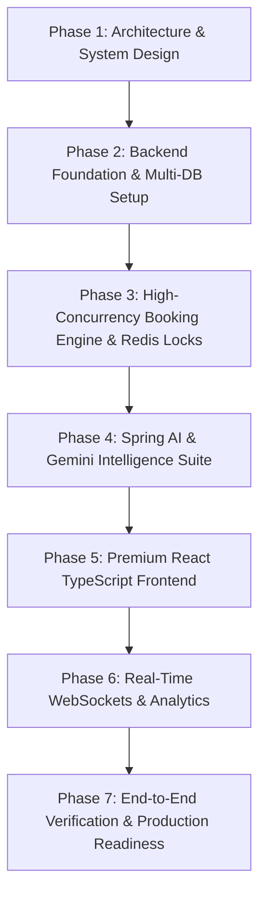

# SeatSync AI – Comprehensive Development Plan & Roadmap

## 1. Executive Summary & Vision

**SeatSync AI** is an enterprise-grade, intelligent event discovery, recommendation, and real-time seat reservation platform built with a modern full-stack architecture:
- **Backend:** Java 21, Spring Boot 3.4.x, Spring Security 6, Spring Data JPA, Redis, WebSocket with STOMP, Spring AI.
- **AI Core:** Google Gemini 3.5 API, Spring AI ChatClient, Tool Calling Agents, Semantic Search with pgvector, Grounded RAG for policy & support, Intelligent Adjacent Seat Recommendation Algorithms.
- **Data Tier:** Dual-engine architecture featuring **MySQL 8.0** for ACID transactional booking operations and **PostgreSQL 16 + pgvector** for high-dimensional semantic embeddings, paired with **Redis 7.0** for sub-millisecond temporary seat holds and cache invalidation.
- **Frontend:** React 18, TypeScript, Vite, Tailwind CSS, Recharts, Lucide Icons, STOMP.js client over SockJS.
- **DevOps:** Docker multi-stage builds, Docker Compose, GitHub Actions CI/CD pipeline, AWS deployment readiness.

---

## 2. Phase-by-Phase Execution Roadmap

### Phase 1: Architecture, Schemas & System Specifications (Current Phase)
- [x] Analyze complete functional and non-functional requirements.
- [x] Author comprehensive architecture design document (`ARCHITECTURE.md`).
- [x] Design normalized relational schema (MySQL) and vector embeddings schema (`pgvector`) (`DATABASE_DESIGN.md`).
- [x] Author REST API contracts and WebSocket protocols (`API_DOCUMENTATION.md`).
- [x] Define multi-tier folder hierarchy for Spring Boot and React applications.
- [x] Define AI integration architecture (Agent workflows, Tool calling, RAG pipelines, Semantic Search).
- [ ] Submit Phase 1 to user for review and formal approval.

### Phase 2: Backend Foundation & Security (MySQL Authoritative Baseline)
- [ ] Initialize Spring Boot 3.4.2 (Java 21 LTS) clean modular monolithic project.
- [ ] Configure **MySQL 8.0** as the primary and sole authoritative data source for Phase 2.
- [ ] Implement JPA Entities, Repositories, and schema migrations (`users`, `roles`, `venues`, `events`, `seats`, `event_seats`, `bookings`, `booking_items`, `payments`, `tickets`, `audit_logs`).
- [ ] Configure Spring Security 6 with stateless JWT authentication filter, BCrypt password hashing, and role hierarchy (`ROLE_CUSTOMER`, `ROLE_ORGANIZER`, `ROLE_ADMIN`).
- [ ] Implement Authentication API: `/api/auth/register`, `/api/auth/login`, `/api/auth/refresh`, `/api/auth/me`.
- [ ] Implement Global Exception Handling (`@RestControllerAdvice`) and standard API response envelope (`ApiResponse<T>`).
- [ ] Write JUnit 5 & Mockito unit tests for authentication and authorization.

### Phase 3: High-Concurrency Booking Engine & Redis Holds (Introduce Redis 7.0)
- [ ] Introduce **Redis 7.0** into the stack for ephemeral 5-minute seat holds and lock coordination.
- [ ] Document & enforce that **Redis is strictly non-authoritative**; MySQL is the sole source of truth for holds and checkouts.
- [ ] Implement Event, Venue, and Seat Layout management modules.
- [ ] Implement Seat Matrix generation and status management (`AVAILABLE`, `HELD`, `BOOKED`, `BLOCKED`).
- [ ] Implement 5-minute Redis Seat Hold engine:
  - Atomic multi-seat hold acquisition via Redis Lua script (prevents race conditions).
  - Compensation Rollback: If MySQL conditional update fails, immediately evict Redis hold keys.
  - Stale key reconciliation: If Redis has a stale hold key while MySQL reports `BOOKED`, the sweeper reads the observed Redis token and executes atomic CAD (never blind `DEL`); for unbooked holds, normal ownership token checks and 3-attempt backoff retries apply.
  - MySQL `event_seats` status update with `@Version` optimistic locking and CAS condition.
  - Background Reaper Service (Spring `@Scheduled(fixedDelay = 15000)`) executing the **Strict Safe 9-Step Expired-Hold Reconciliation Sequence**:
    1. Start a MySQL transaction and lock the relevant `event_seats` row using `SELECT ... FOR UPDATE`.
    2. Verify that the seat is still `HELD`.
    3. Verify that `hold_token` matches the original expected token.
    4. Verify that `held_until <= NOW()`.
    5. If all conditions match, conditionally update the seat to `AVAILABLE` and clear the old hold information (`held_by_user_id = NULL`, `held_until = NULL`, `hold_token = NULL`).
    6. Commit the MySQL transaction.
    7. Execute Redis atomic compare-and-delete (CAD) using the original expected hold token.
    8. If Redis contains a different token, do not delete it (preserves newer hold).
    9. If the MySQL conditions do not match, do not reset the seat or delete the Redis key (roll back, re-read latest state, and retry safely if appropriate).
  - Concurrency guarantees: MySQL row locking prevents concurrent modifications during reconciliation; expected-token condition stops a slow sweeper from wiping a newer hold; Redis CAD prevents blind deletes; MySQL remains authoritative even if Redis operations fail.
- [ ] Implement Idempotent Booking Checkout & Mock Payment service:
  - Strict conditional checkout update: `WHERE status = 'HELD' AND held_by_user_id = :userId AND held_until > NOW() AND current_booking_id IS NULL`.
  - All-or-Nothing Rollback Invariant: If affected rows != requested seat count, the entire database transaction rolls back immediately (zero partial bookings).
  - Pessimistic row locking (`SELECT ... FOR UPDATE`) option for high-contention flash sales.
  - Idempotency key tracking in Redis and MySQL.
  - Atomic transition from `HELD` to `BOOKED` within a database transaction binding `current_booking_id`.
  - Cryptographic ticket generation (UUID ticket tokens + HMAC-SHA256 signature for QR code).
- [ ] Write high-concurrency JMeter/JUnit multi-threaded tests simulating 100 concurrent users fighting for the same seat (ensuring strictly 1 succeeds and 99 fail cleanly).

### Phase 4: Spring AI & Gemini Intelligence Suite (Introduce PostgreSQL 16 + pgvector)
- [ ] Introduce **PostgreSQL 16 with pgvector** for high-dimensional semantic vector search and RAG.
- [ ] Configure Spring AI 1.0.0 (GA) BOM via Maven Central using the dedicated `spring-ai-starter-model-google-genai` for native Gemini integration.
- [ ] Configure supported model **`gemini-3.5-flash`** using documented property paths: `spring.ai.model.chat=google-genai`, `spring.ai.google.genai.api-key=${GEMINI_API_KEY}`, `spring.ai.google.genai.chat.model=gemini-3.5-flash`, and `spring.ai.google.genai.chat.temperature=0.7` (do not use `chat.options.temperature`).
- [ ] Configure `spring-ai-starter-vector-store-pgvector` for vector storage and cosine similarity retrieval.
- [ ] Asynchronous event embedding pipeline (`@TransactionalEventListener(AFTER_COMMIT)`) synchronizing MySQL event catalog changes to pgvector.
- [ ] Feature 1 – **Intelligent Booking Assistant**:
  - ChatClient configured with prompt templates, conversation history, and tool callbacks.
- [ ] Feature 2 – **Semantic Event Search**:
  - Generate embeddings for event titles, descriptions, and categories.
  - Store and query high-dimensional vectors in PostgreSQL using `pgvector` HNSW cosine similarity.
- [ ] Feature 3 – **RAG-Based Customer Support**:
  - Ingestion pipeline for policy documents (Refund, Cancellation, Event FAQs).
  - Text splitting into chunks, embedding generation, vector store retrieval, and grounded response generation with citations.
- [ ] Feature 4 – **AI Smart Seat Recommendation**:
  - Natural language preference parser (e.g., "3 contiguous seats, middle row, under ₹1200").
  - Java spatial contiguous seat search algorithm (evaluates Euclidean distance to stage, row alignment, price).
  - Gemini-generated explanatory narrative for the recommendations.
- [ ] Feature 5 – **Personalized Event Recommendations**:
  - Collaborative and content-based scoring combining user past bookings, categories, and vector similarity.
- [ ] Feature 6 – **Agent Tool Calling Guardrails**:
  - Register Spring AI `@Tool` functions (`searchEvents`, `getEventDetails`, `checkSeatAvailability`, `recommendSeats`, `getBookingDetails`).
  - Zero-write tool policy, IDOR protection via `SecurityContextHolder`, and strict Jakarta Bean Validation.
- [ ] Feature 7 – **Conversation Memory**:
  - User/session isolated sliding window conversation memory.

### Phase 5: Modern SaaS Frontend (React, TypeScript & Tailwind)
- [ ] Initialize Vite + React 18 + TypeScript project with Tailwind CSS and Lucide Icons.
- [ ] Design System implementation:
  - Dark Navy & Purple luxury aesthetic (`#0B0F19`, `#1E1035`, `#7C3AED`, `#10B981`).
  - Glassmorphism, smooth animations, responsive grids.
- [ ] Build Public Pages:
  - Landing page with hero banner, live trending events, category filters, and features showcase.
  - Login & Registration modals/pages with form validation.
  - Event Discovery with dual search (keyword search and semantic AI search).
  - Event Details page with venue details, artist line-up, pricing tiers, and calendar selector.
- [ ] Build Interactive Seat Map:
  - Canvas/SVG rendered seat grid showing sections (VIP, Platinum, Gold, Silver).
  - Real-time seat color coding: Available (Emerald), Held (Amber with countdown), Booked (Slate/Red), Selected (Electric Purple).
  - Tooltips with row, number, section, and price.
- [ ] Build Conversational AI Concierge UI:
  - Interactive chat drawer & full-screen view.
  - Rich chat bubbles rendering markdown, interactive event cards, and seat recommendation pills.
  - Suggested prompts and RAG citation badges.
- [ ] Build Customer Dashboard:
  - Booking history, digital ticket view with dynamic QR Code display, profile preferences.
- [ ] Build Admin & Organizer Dashboards:
  - Metrics cards (Total Revenue, Active Events, Seat Occupancy Rate).
  - Recharts revenue trends and category distribution charts.
  - Event and Venue CRUD management with seat layout builder.

### Phase 6: Real-Time WebSockets & Advanced Features
- [ ] Spring STOMP WebSocket broker configuration over SockJS.
- [ ] Client subscriptions to `/topic/events/{eventId}/seats`:
  - Instant broadcast when seats are held, released, or booked.
  - Dynamic seat status updates without page refresh.
- [ ] Real-time Admin Dashboard push for live ticket sales and venue capacity meters.
- [ ] QR Code generation and ticket download (PNG/PDF).
- [ ] In-app notifications system for hold expirations and booking confirmations.

### Phase 7: Verification, Containerization & Production Readiness
- [ ] Comprehensive unit, integration, and load tests.
- [ ] Multi-stage production `Dockerfile` for Spring Boot (distroless/Alpine JRE 21).
- [ ] Optimized `Dockerfile` for React (multi-stage build with Nginx reverse proxy).
- [ ] Production-ready `docker-compose.yml` orchestrating MySQL, PostgreSQL/pgvector, Redis, Backend, and Frontend.
- [ ] GitHub Actions CI workflow for automated build, test, and container packaging.
- [ ] Production runbook and AWS ECS/EKS deployment guide.
- [ ] Final project documentation and demonstration guide.

---

## 3. Risk Mitigation & Quality Guardrails

| Risk Area | Mitigation Strategy |
|---|---|
| **Double Booking Race Condition** | Two-tier locking: Redis atomic Lua script temporary lock + MySQL optimistic locking (`@Version`) + DB unique constraint on `(event_id, seat_id)`. |
| **Partial Hold / Lock Inconsistency** | Compensation Rollback: If MySQL conditional update fails or throws `OptimisticLockException`, a compensating Redis Lua script immediately deletes the newly acquired keys. |
| **Cancelled Seat Rebooking & Exclusivity** | `UNIQUE (booking_id, event_seat_id)` prevents duplicates per booking. Cross-booking active exclusivity is strictly enforced by MySQL InnoDB row locking (`FOR UPDATE`) or conditional CAS update (`WHERE current_booking_id IS NULL`). |
| **Stale Redis Keys on Delete Failure** | Multi-tiered reconciliation: Observed-token atomic CAD when MySQL is `BOOKED` (never blind `DEL`) + ownership token CAD for unbooked expired holds + 3-attempt jittered retry backoff + 300s TTL safety floor. |
| **Orphaned Seat Holds & Sweeper Races** | Strict Safe 9-Step Reconciliation: 1) Lock `event_seats` via `SELECT ... FOR UPDATE`, 2) Verify `status == 'HELD'`, 3) Verify expected `hold_token`, 4) Verify `held_until <= NOW()`, 5) Conditionally update to `AVAILABLE` & clear hold, 6) Commit MySQL, 7) Execute Redis atomic CAD using expected token, 8) Preserve newer holds if token changed, 9) Rollback on condition mismatch. Row locks serialize competing modifications; expected-token checks stop slow sweepers from wiping newer holds; atomic CAD prevents blind deletes; MySQL remains authoritative if Redis fails. |
| **LLM Hallucinations in Policies** | Strict RAG prompt constraints ("answer only using the retrieved context; if unavailable, say you do not know") + temperature set to 0.1 for support agent + delimited `<policy_context>` tags. |
| **LLM Unauthorized Actions & IDOR** | Zero-trust tool execution: tool methods extract user identity strictly from `SecurityContextHolder`, not from LLM arguments. No tool directly executes payment or booking confirmation (proposal-only pattern). |
| **Dual Database Synchronicity** | Relational transactions reside exclusively in MySQL. PostgreSQL pgvector acts purely as an analytical/semantic read-optimized store synchronized asynchronously via Spring Data JPA domain events (`@TransactionalEventListener`). |
| **Spring AI Stability & Resolution** | Uses stable **Spring Boot 3.4.2** with **Spring AI 1.0.0 (GA)** from Maven Central via the dedicated `spring-ai-starter-model-google-genai` configured with supported model `gemini-3.5-flash`. |

