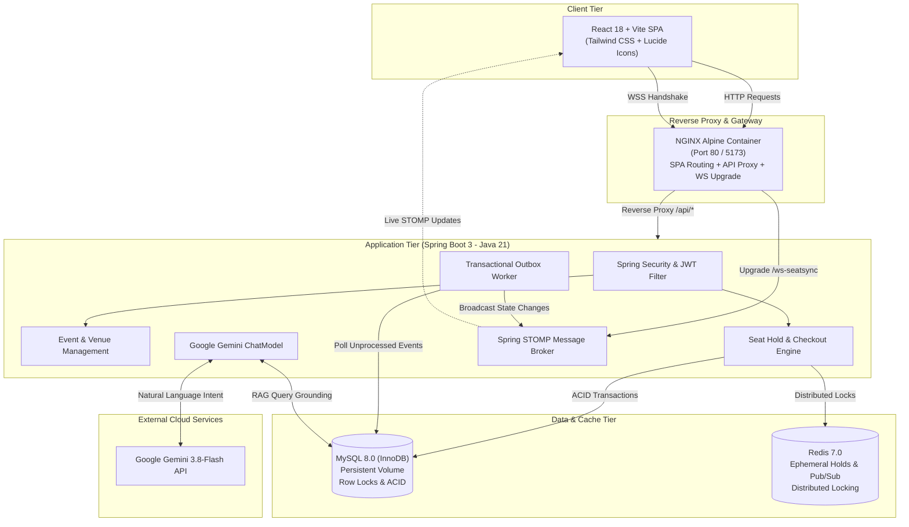

# SeatSync AI — Intelligent Event Discovery & Live Booking Platform

[](https://www.oracle.com/java/)
[](https://spring.io/projects/spring-boot)
[](https://react.dev/)
[](https://www.typescriptlang.org/)
[](https://vitejs.dev/)
[](https://tailwindcss.com/)
[](https://www.mysql.com/)
[](https://redis.io/)
[](https://aistudio.google.com/)
[](https://www.docker.com/)

SeatSync AI is an enterprise-grade, high-concurrency event ticketing and interactive seat reservation platform. Built with **Spring Boot 3 (Java 21)** and **React 18 (TypeScript)**, SeatSync AI solves real-world ticketing challenges: race-condition-free seat reservations via **Redis distributed locks**, real-time seat matrix synchronization with **STOMP WebSockets**, reliable event emission via the **Transactional Outbox Pattern**, and AI-powered event discovery using **Google Gemini AI**.

---

## Table of Contents

- [Key Features](#key-features)
- [System Architecture](#system-architecture)
- [Technology Stack](#technology-stack)
- [Project Structure](#project-structure)
- [Getting Started](#getting-started)
  - [Prerequisites](#prerequisites)
  - [Environment Configuration](#environment-configuration)
  - [Running with Docker Compose (Recommended)](#running-with-docker-compose-recommended)
  - [Running Locally for Development](#running-locally-for-development)
- [API Overview](#api-overview)
- [Testing & Quality Assurance](#testing--quality-assurance)
- [Security & Compliance](#security--compliance)
- [License](#license)

---

## Key Features

### 1. High-Concurrency Distributed Seat Holds (Redis + MySQL)
- **Zero Race Conditions:** Ephemeral 5-minute seat reservations managed via Redis distributed locking with atomic check-and-set semantics.
- **Auto-Expiration:** Automatic Time-To-Live (TTL) expiration in Redis seamlessly returns unbooked seats to the general inventory.
- **Idempotency Guarantee:** Checkout endpoints enforce cryptographically unique client idempotency keys, eliminating duplicate credit card charges and double-bookings.

### 2. Live Interactive Seating Map & Real-Time Sync
- **Interactive SVG Seating Matrix:** Tier-based visual seat map (VIP, Platinum, Gold) with dynamic row-by-row rendering.
- **Bi-Directional STOMP WebSockets:** Real-time push updates broadcast seat transitions (`AVAILABLE` &rarr; `HELD` &rarr; `BOOKED`) across all concurrent users within milliseconds.
- **Client Auto-Recovery:** Automatic WebSocket reconnection with delta re-synchronization.

### 3. Google Gemini AI Event Concierge
- **Natural Language Search:** Discover events, performers, venues, and ticket budgets through natural conversation (e.g., *"Find rock concerts in Mumbai this weekend under ₹3,000"*).
- **Retrieval-Augmented Generation (RAG):** Gemini analyzes user intent, executes deterministic MySQL queries against published events, and synthesizes grounded, factually accurate recommendations.
- **Graceful Fallback:** Automatic failover to local catalog search if cloud AI services experience transient latency or rate limits.

### 4. Enterprise Resilience & Data Integrity
- **Transactional Outbox Pattern:** Decouples MySQL transactions from Redis WebSocket broadcast workers, guaranteeing zero message loss even under network partitions.
- **Versioned Database Migrations:** Flyway schema migrations (`V1`, `V2`, `V3`) enforce strict preflight validations, indexing rules, and seating foundation schemas.
- **Role-Based Access Control (RBAC):** Granular permission enforcement (`ROLE_CUSTOMER`, `ROLE_ORGANIZER`, `ROLE_ADMIN`) with stateless JWT authentication and refresh token rotation.

---

## System Architecture



---

## Technology Stack

| Domain | Technology | Version | Purpose |
| :--- | :--- | :--- | :--- |
| **Backend** | Java | 21 (LTS) | Core application runtime |
| | Spring Boot | 3.4.2 | Application framework & dependency injection |
| | Spring Security | 6.2 | Stateless JWT authentication & RBAC |
| | Spring Data JPA | 3.4.2 | Hibernate ORM entity management & ACID transactions |
| | Spring WebSocket | 3.4.2 | STOMP sub-protocol messaging over WebSockets |
| | Spring AI | 1.0.0-M5 | Google Gemini ChatModel integration |
| | Flyway | 10.20.1 | Database schema migrations & version control |
| **Frontend** | React | 18.3.1 | Single-Page Application UI library |
| | TypeScript | 5.5.3 | Static type safety |
| | Vite | 6.0.0 | High-performance frontend build tool |
| | Tailwind CSS | 3.4.1 | Utility-first responsive styling |
| | @stomp/stompjs | 7.0.0 | Browser-native STOMP WebSocket client |
| | Axios | 1.7.9 | HTTP client with automatic auth interceptors |
| **Infrastructure** | MySQL | 8.0 | Primary relational database with InnoDB row locks |
| | Redis | 7.0 (Alpine) | Distributed caching and TTL seat hold coordination |
| | NGINX | 1.27 (Alpine) | Static asset serving, proxying, and WebSocket upgrades |
| | Docker & Compose | v2+ | Multi-container coordination & isolated bridge network |

---

## Project Structure

```text
SeatSync-AI/
├── backend/                       # Spring Boot 3 Java 21 Service
│   ├── src/main/java/com/seatsync/
│   │   ├── common/               # Shared configs, security, JWT, Redis, WebSockets
│   │   └── modules/
│   │       ├── ai/               # Gemini AI prompt engineering, RAG & chat controllers
│   │       ├── auth/             # User registration, authentication, RBAC
│   │       ├── booking/          # Seat hold engine, checkout, outbox worker, payments
│   │       └── event/            # Events, venues, seating tiers, category management
│   ├── src/main/resources/
│   │   ├── application.yml       # Base configuration with environment placeholders
│   │   ├── application-prod.yml  # Docker & production profile settings
│   │   └── db/migration/         # Flyway SQL migrations (V1, V2, V3)
│   ├── Dockerfile                # Multi-stage Maven 3.9 + Temurin 21 JRE image
│   └── pom.xml                   # Maven dependencies and build plugins
├── frontend/                      # React 18 + TypeScript + Vite SPA
│   ├── src/
│   │   ├── api/                  # Axios API clients (auth, events, booking, AI)
│   │   ├── components/           # Reusable UI components & navigation
│   │   ├── context/              # Authentication & User state context
│   │   ├── hooks/                # Custom hooks (useSeatWebSocket, debounce, timer)
│   │   ├── pages/                # Views (EventCatalog, SeatSelection, Checkout, Login)
│   │   └── types/                # TypeScript data interfaces & API contracts
│   ├── nginx.conf                # NGINX reverse-proxy & WebSocket configuration
│   └── Dockerfile                # Multi-stage Node 22 + NGINX Alpine image
├── docker-compose.yml             # Orchestration for MySQL, Redis, Backend, Frontend
├── .env.example                   # Safe template for environment variables
├── ARCHITECTURE.md                # In-depth architectural specification
├── API_DOCUMENTATION.md           # Comprehensive REST & WebSocket endpoint guide
├── DATABASE_DESIGN.md             # Complete database schema & indexing strategy
└── README.md                      # Project documentation (this file)
```

---

## Getting Started

### Prerequisites
- [Docker Desktop](https://www.docker.com/products/docker-desktop/) (version 24+ recommended with Compose v2)
- Or for local non-Docker development:
  - Java 21 JDK (e.g., Eclipse Temurin or Oracle JDK 21)
  - Node.js 20+ & npm 10+
  - MySQL Server 8.0
  - Redis Server 7.0

---

### Environment Configuration

1. Copy the provided `.env.example` template to `.env` in the project root:
   ```bash
   cp .env.example .env
   ```

2. Open `.env` and fill in your private credentials. **All values are kept strictly on your local machine and are ignored by Git**:

   ```env
   # 1. Google Gemini AI Configuration
   # Obtain a free key from Google AI Studio: https://aistudio.google.com/
   GEMINI_API_KEY=your_gemini_api_key_here
   GEMINI_MODEL=gemini-3.8-flash

   # 2. Database & Cache Credentials
   MYSQL_ROOT_PASSWORD=your_secure_mysql_root_password
   MYSQL_HOST_PORT=3307
   REDIS_HOST_PORT=6380

   # 3. Application Security (256-bit Hexadecimal Secret)
   JWT_SECRET=your_256_bit_cryptographic_jwt_secret_here
   JWT_ACCESS_TOKEN_EXPIRATION_MS=900000
   JWT_REFRESH_TOKEN_EXPIRATION_MS=604800000

   # 4. Networking & Ports
   BACKEND_PORT=8081
   FRONTEND_PORT=80
   CORS_ALLOWED_ORIGINS=http://localhost,http://localhost:80,http://localhost:5173,http://localhost:3000
   ```

---

### Running with Docker Compose (Recommended)

Launch the entire stack (MySQL 8, Redis 7, Spring Boot, and NGINX Frontend) with a single command:

```bash
docker compose up -d --build
```

#### Monitor Container Health:
```bash
docker compose ps
```

Once all containers report **`(healthy)`**, open your browser:

- **Frontend Application:** [http://localhost](http://localhost) (or [http://localhost:5173](http://localhost:5173))
- **Backend API Direct:** [http://localhost:8081](http://localhost:8081)
- **Actuator Health Endpoint:** [http://localhost:8081/actuator/health](http://localhost:8081/actuator/health)

#### Stop the Containers:
```bash
docker compose down
```
*(Note: Never run `docker compose down -v` unless you explicitly intend to delete the persistent MySQL volume data.)*

---

### Running Locally for Development

#### 1. Start MySQL & Redis
Ensure MySQL 8 is running on port 3306 (with a database named `seatsync_db`) and Redis is running on port 6379.

#### 2. Start the Spring Boot Backend
```bash
cd backend
mvn clean spring-boot:run -Dspring-boot.run.profiles=dev
```
The backend initializes on [http://localhost:8081](http://localhost:8081) and automatically executes Flyway migrations.

#### 3. Start the React Frontend
```bash
cd frontend
npm install
npm run dev
```
The Vite development server starts with instant hot-module replacement on [http://localhost:5173](http://localhost:5173).

---

## API Overview

For detailed request/response schemas, refer to [API_DOCUMENTATION.md](file:///d:/SeatSync-AI/API_DOCUMENTATION.md).

### Authentication & User Management
| Method | Endpoint | Access | Description |
| :--- | :--- | :--- | :--- |
| `POST` | `/api/auth/register` | Public | Register a new customer or organizer account |
| `POST` | `/api/auth/login` | Public | Authenticate user; returns JWT access & refresh tokens |
| `POST` | `/api/auth/refresh` | Public | Rotate refresh token and acquire a new access token |
| `GET` | `/api/auth/me` | Authenticated | Retrieve current user profile and role claims |

### Events & Seating Matrix
| Method | Endpoint | Access | Description |
| :--- | :--- | :--- | :--- |
| `GET` | `/api/events` | Public | Paginated list of published events with filters & sorting |
| `GET` | `/api/events/{id}` | Public | Detailed event information, venue specifications, and pricing |
| `GET` | `/api/events/{id}/seats`| Public | Real-time seat availability matrix by tier (VIP, Platinum, Gold) |
| `POST`| `/api/events` | Organizer / Admin | Create and publish a new event |

### Seat Holds & Booking Checkout
| Method | Endpoint | Access | Description |
| :--- | :--- | :--- | :--- |
| `POST` | `/api/bookings/hold` | Authenticated | Acquire an ephemeral 5-minute Redis hold on up to 8 seats |
| `DELETE`| `/api/bookings/hold`| Authenticated | Manually release an active hold using `holdToken` |
| `POST` | `/api/bookings` | Authenticated | Complete checkout using hold token & client idempotency key |
| `GET` | `/api/bookings/my-bookings`| Authenticated | Retrieve user booking history and confirmed tickets |

### AI Assistant & WebSockets
| Protocol | Destination | Description |
| :--- | :--- | :--- |
| `POST` | `/api/ai/chat` | Natural language event discovery powered by live Google Gemini AI |
| `WSS` | `/ws-seatsync` | STOMP WebSocket connection endpoint (authenticated) |
| `SUB` | `/topic/events/{id}/seats`| Real-time topic broadcasting seat transitions (`AVAILABLE`, `HELD`, `BOOKED`) |

---

## Testing & Quality Assurance

SeatSync AI includes comprehensive automated test suites covering unit logic, database migrations, high-concurrency race condition protections, and integration flows:

### Run Backend Tests
```bash
cd backend
mvn test
```
- **Concurrency & Race Conditions:** [`LiveMySqlAndRedisHoldEngineTest.java`](file:///d:/SeatSync-AI/backend/src/test/java/com/seatsync/booking/LiveMySqlAndRedisHoldEngineTest.java) verifies 50+ concurrent requests competing for the exact same seat; exactly one wins while 49 are safely rejected.
- **Transactional Outbox:** [`OutboxWorkerAndWebSocketIntegrationTest.java`](file:///d:/SeatSync-AI/backend/src/test/java/com/seatsync/booking/OutboxWorkerAndWebSocketIntegrationTest.java) verifies guaranteed delivery of seat state events to WebSockets.
- **Migration Resilience:** [`V3MigrationIsolatedTest.java`](file:///d:/SeatSync-AI/backend/src/test/java/com/seatsync/migration/V3MigrationIsolatedTest.java) and [`V3PartialDdlRecoveryTest.java`](file:///d:/SeatSync-AI/backend/src/test/java/com/seatsync/migration/V3PartialDdlRecoveryTest.java) test Flyway rollback and idempotent re-application under transient faults.

### Run Frontend Build & Typecheck
```bash
cd frontend
npm run build
```
- Enforces strict TypeScript compile-time checking (`tsc -b`) and asset bundling via Vite with zero warnings.

---

## Security & Compliance

- **Stateless Authentication:** Passwords hashed with BCrypt (strength 10). Cryptographically signed HMAC-SHA256 JWT tokens.
- **Defense in Depth:** In-memory client rate limiting and strict CORS origin whitelisting.
- **Input Sanitization & Constraints:** Bean Validation (`jakarta.validation`) on all REST DTOs prevents SQL injection and buffer overflow attacks.
- **Zero Committed Secrets:** Git configurations strictly exclude all `.env` files, database dumps, and private certificates.

---

## Placement & Author Information

- **Project:** SeatSync AI — Intelligent Event Discovery & Live Booking Platform
- **Architecture & Engineering:** Manikanta Suri
- **Focus Areas:** Distributed Systems, High-Concurrency Transaction Management, Cloud AI Integration, Full-Stack Engineering (Java / React)

